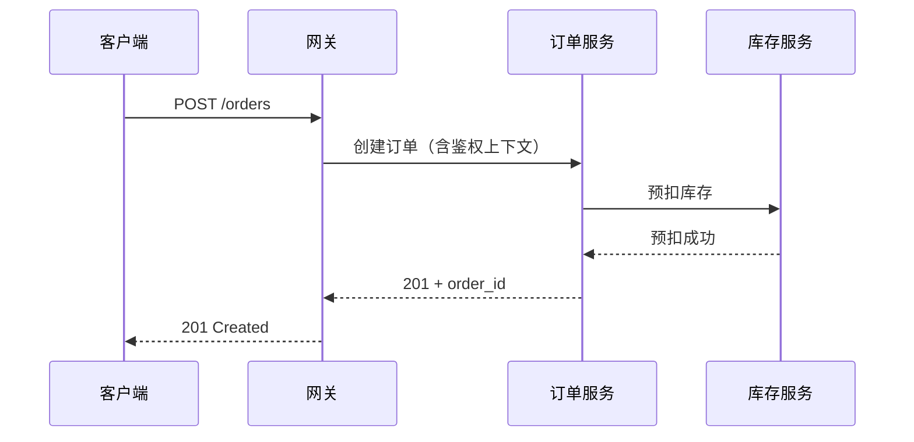
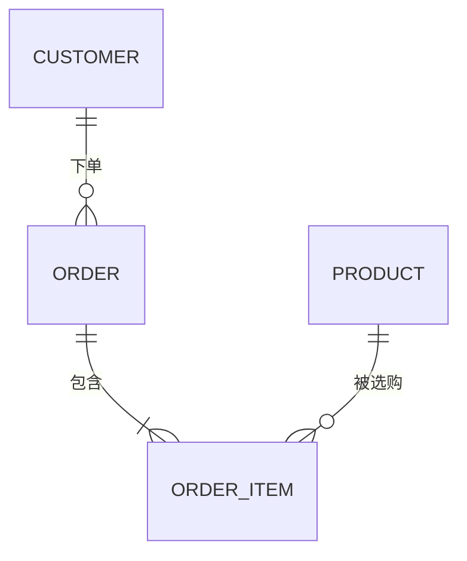
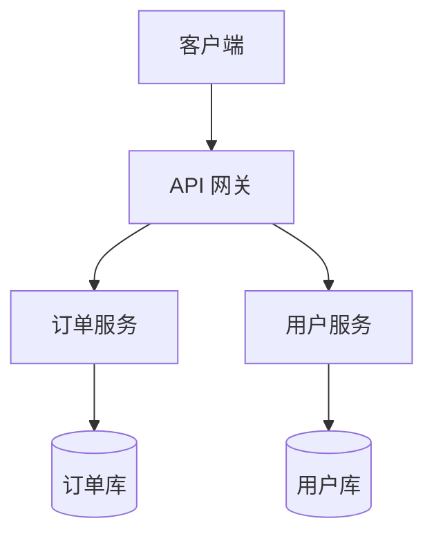

# 设计文档图表运用指南

> arch skill 图表能力细则。SKILL.md「图表运用原则」章节是本文件的判定摘要（速查表 + 边界），
> 本文件承载完整细则：选型方法、mermaid 书写规范、ASCII 回退条件、职责边界与审查清单。

---

## 核心理念

图表是为「直观传递设计概念」服务的，不是装饰。判断标准很简单：一段需要读者在脑中重建
组件关系/执行顺序/流转路径的文字描述，就该换成一张图——读者扫一眼得到的结构感，胜过三段 prose。

**选型顺序**：先识别要表达的概念类型（结构？顺序？流转？关系？），再对照选型表拿图类型——
而不是反过来"决定画个图，再想画什么"。概念类型判断错了，图画得再漂亮也是误导。

---

## 图表选型表（按概念类型）

| 概念类型 | 典型场景 | 推荐图类型 | mermaid 语法 |
|---------|---------|-----------|-------------|
| 系统结构/组件拓扑 | 分层架构、服务依赖、部署拓扑 | 架构图（architecture diagram） | `flowchart TB` / `flowchart LR` |
| 交互顺序 | 跨服务调用链、协议握手、生命周期钩子顺序 | 时序图（sequence diagram） | `sequenceDiagram` |
| 业务流程/决策流转 | 审批流、请求处理管道、异常分支走向 | 流程图（flowchart） | `flowchart TD` |
| 状态流转 | 资源状态机、订单/任务生命周期 | 状态图（state diagram） | `stateDiagram-v2` |
| 数据模型/实体关系 | 表关系、领域模型、外键约束 | E-R 图（entity-relationship diagram） | `erDiagram` |
| 类/接口关系 | 继承层次、接口抽象、组合关系 | 类图（class diagram） | `classDiagram` |

**类型是开放集**：垂直领域有更贴切的表达（C4 模型、数据流图 DFD、网络拓扑、泳道图等）时，
按「最能直观传递概念」原则选用，不限于上表。例：描述 money flow 用数据流图、描述 K8s 部署
用带命名分区的 flowchart，都比硬套 E-R 图贴切。

---

## mermaid 书写规范（默认渲染）

默认用 ```mermaid 围栏——GitHub / GitLab / 主流 Markdown 渲染器原生支持，版本库内 diff 友好。

1. **每图必有图题**：图上方一行加粗标题（如 `**图 3-1 请求处理时序**`），正文引用图题编号。
   孤图（没有任何正文提及）要么删除、要么补引用——读者需要知道"看这张图是为了理解什么"。

2. **规模控制**：单图节点 ≤ 15 个、时序消息 ≤ 20 条、总行数 ≤ 50。超出即拆分——这与 SKILL.md
   「文档长度控制原则」中"大型时序图/流程图 > 50 行拆分子文档"是同一条规则的执行细则。
   一张塞了 30 个节点的图不叫"宏观视野"，叫"没人看得懂"。

3. **方向与视线一致**：层次结构用 `TB`（自上而下），管道/流程用 `LR`（从左到右）。
   读者视线动线应与语义方向一致——层次图横向铺开会让"上下层"关系变模糊。

4. **节点命名可读**：节点 id 用英文短标识（`gw`、`svc_order`），显示标签用业务命名
   （`网关`、`订单服务`）。禁止 `A`/`B`/`C` 无意义编号——图例要靠命名自解释，不靠查表。

**示例 1：时序图（跨服务调用链）**

**图 5-1 订单创建时序**



**示例 2：E-R 图（数据模型）**

**图 2-3 订单域实体关系**



**示例 3：架构图（分层拓扑）**

**图 1-2 服务分层架构**



---

## ASCII 图回退（备用选项）

mermaid 是默认，以下场景回退为 ASCII 风格图（普通 ``` 围栏）：

1. **纯文本环境**：commit message、diff/MR 行内评论、terminal 输出、代码注释——mermaid
   不会被渲染，代码块原文反而是噪音。
2. **mermaid 表达力不足**：需要精确对齐的矩阵式结构、带大量旁注的示意图、非标准拓扑。
3. **读者环境未知且图很简单**：≤ 2 层结构、≤ 5 个框，ASCII 一眼能看懂时无需动用渲染器。

**ASCII 示例**：

```
┌─────────┐      ┌──────────┐      ┌─────────┐
│  网关   │ ───> │ 订单服务 │ ───> │ 订单库  │
└─────────┘      └──────────┘      └─────────┘
                      │
                      ▼ 预扣
                 ┌──────────┐
                 │ 库存服务 │
                 └──────────┘
```

注意：ASCII 图同样受规模控制（≤ 15 个框），且对齐宽度在等宽字体外会散架——正式设计文档
优先 mermaid，ASCII 主要服务纯文本场景。

---

## 职责边界（arch 不生成的图表）

arch 只负责**系统方案/宏观设计的概念图**。以下两类图表有专门归属，arch 不生成：

| 图表类别 | 例子 | 归属 skill | 边界依据 |
|---------|------|-----------|---------|
| UI/UX 视觉设计稿 | 线框图、高保真原型、交互流程原型、配色/排版方案 | **/ued** | 视觉与交互设计是专业领域，需要专门的设计流程与产出规范（ued 有线框模板、HTML 原型指南） |
| 项目管理类图表 | 甘特图、鱼骨图、燃尽图、燃起图 | **/pm** | 表达的是项目进度/排期/归因，属项目管理域而非系统设计概念（pm 有项目管理图表指引） |

**转介动作**：用户需求涉及上述两类时，不在 arch 文档中生成，明确告知用户——
「此类图表由 /{skill} 负责实现」。arch 文档中只保留系统设计相关的概念图。

**辨析（易混淆场景）**：
- 系统的**页面路由结构/信息架构** → 属系统设计，arch 画（flowchart）
- 页面**长什么样**（布局/视觉层级）→ /ued
- 部署上线的**阶段顺序图**（表达技术发布步骤）→ 属系统设计，arch 画（flowchart/sequence）
- **迭代排期**甘特图（表达人力与时间）→ /pm

---

## 审查清单（设计文档更新时自查）

- [ ] 每张图有图题且被正文引用（孤图删或补引用）
- [ ] 图类型与概念类型匹配（对照选型表——状态流转别画成流程图）
- [ ] 单图规模未超限（节点 ≤ 15 / 消息 ≤ 20 / 行数 ≤ 50，超出拆子文档）
- [ ] mermaid 语法可渲染（围栏闭合、节点 id 无重复、箭头语法正确）
- [ ] 未越界：UI 视觉稿 / 项目管理类图表未出现在 arch 文档中
- [ ] 图与正文描述一致（图改了，正文叙述同步改——图是最容易被遗忘的过时产物）
