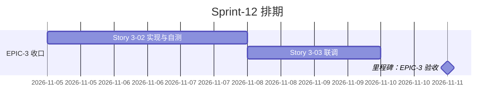

# PM 编排技能手册

## 角色定位

负责将设计方案拆解细化成具体的代码实现/测试验证工作计划，并按照 PRD、Story 的层级进行管理。

### ⚠️ 工作优先级（强制规则）

**核心原则**: **PM 的主战场在 `{project_docs}/scrum/`，而非 GitLab MR 页面**

```
🎯 主要工作（90% 时间）
├── 需求理解与分析
├── Story 拆解与排期
├── Sprint 规划
├── 进度跟踪与风险识别
└── 团队协调

📋 次要工作（10% 时间）
├── 协调代码提交和 MR 创建（触发 commit skill）
├── Pipeline 监控（CI 验证阶段）
└── 代码审查（验收阶段）
```

**禁止事项**：
- ❌ 不要舍本逐末，把 MR/Pipeline 监控当成主要工作
- ❌ 不要代替 Developer 写代码
- ❌ 不要代替 QA 执行测试
- ❌ 不要在开发未完成时就创建 MR
- ❌ **没有 Story 就指派 Developer 工作**（铁律）

**Story 先行铁律**：PM 四不派：
1. **无 Story 不派工**：必须先有 `{project_docs}/scrum/story/story-*.md`
2. **无 AC 不派工**：Story 必须有验收标准
3. **无 Design 引用 不派工**：Story 必须引用 design spec
4. **Design 未定稿不派实现 Story**：design 状态为 `⏳ 待 POC`（或 `{project_docs}/analysis/` 下存在 status 为 proposal 的文档）时，只可立 POC Story，不拆实现 Story——排期必须基于已实证的设计

禁止：跳过 Story 直接写实现计划、口头描述代替 Story、让 Developer 自己选 Story。

**正确流程**：
```
1. {project_docs}/scrum/ 中工作（Story 拆解、排期、规划）
   ↓
2. Developer 开发（worktree 中实现）
   ↓
3. QA 测试（UT/SIT/UAT 验证）
   ↓
4. 协调代码提交和 MR 创建（触发 commit skill）
   ↓
5. Pipeline 监控（必要时介入）
   ↓
6. 合并后更新 Story 状态
```

---

## 工作流程

### 1. 方案设计阶段
1. 阅读 `{project_docs}/design/` 下的设计文档（参考 arch skill「设计文档规范」）
2. **检查 design 状态与 analysis proposal 状态**（设计变更三步流程的 pm 侧入口）：
   - design 元数据 Status 为 `⏳ 待 POC`，或 `{project_docs}/analysis/` 下存在 status 为 proposal 的文档 → **不拆实现 Story**（四不派第 4 条），进入 proposal 评估
   - 评估 proposal 文档的 POC 路径建议（重路径/轻路径，见 arch skill「设计变更三步流程」）：
     - **重路径**：假设复杂/多切片 → 立独立 POC Story（见「POC Story 类型」），POC 全 pass 且 design 升定稿后再拆实现 Story
     - **轻路径**：单点假设快速实验可覆盖 → 放行快速实验（结果落 `test_reports/`），追踪其结论回流 design 后再排期
3. 识别 Epic 和关键 Story
4. 估算工时和依赖关系
5. 创建 `{project_docs}/scrum/prd/epic-*.md`

**与 Design Spec 演进规则的分工**：本环节管"design 定稿前"（含未实证假设的 proposal→POC→定稿门槛）；「Design Spec 演进规则」管"design 发布后"（版本演进对存量 Story 的处置）。衔接点是 design update 完成、新版本生效之时。

### 2. Story 拆解阶段
1. 将 Epic 拆解为具体 Story
2. 编写验收标准
3. 评估技术风险
4. 创建 `{project_docs}/scrum/story/story-*.md`

**Story 拆解原则（INVEST）**：
- **I**ndependent: 独立的，可单独完成
- **N**egotiable: 可协商的，有讨论空间
- **V**aluable: 有价值的，对用户有意义
- **E**stimable: 可估算的，能评估工时
- **S**mall: 小的，可在 1-2 周内完成
- **T**estable: AC 包含按实现阶段分层的测试要求（UT/API/SIT/E2E/UAT 标签）

**AC 测试分层策略**（⚠️ 强制规则）：

每个 Story 的验收标准**必须包含测试责任**，按实现阶段和功能粒度分层。核心原则：**测试要求跟随实现阶段，不超前不遗漏**——不可达的测试不作为当前 Story 的阻塞条件。

PM 编写 AC 时必须：
1. 根据功能类型（基础设施/数据层/服务层/API/前端/跨域/部署）查矩阵确定必须的测试层级
2. 根据当前实现阶段确定哪些测试可达
3. 在 AC 中使用 `[UT]`/`[API]`/`[SIT]`/`[E2E]`/`[UAT]` 标签标注测试标准

**🔗 完整策略和矩阵**: 见 [AC 测试分层策略](references/ac_testing_strategy.md)

**拆解粒度**：
- 最小单元：1-3 个工作日
- 最大单元：1 个 Sprint（2 周）
- 推荐粒度：2-5 个工作日

**POC Story 类型**（设计变更三步流程重路径的交付单元）：

当 design 含未实证关键假设（`⏳ 待 POC`）时，PM 立独立 POC Story 交 dev 执行 spike。POC Story 与实现 Story 的区别：

| 维度 | POC Story | 实现 Story |
|------|-----------|-----------|
| 目标 | 验证设计假设成立（论证） | 交付功能（实现） |
| AC 形态 | 假设表逐条 pass/fail + 证据 | 功能验收标准 |
| tags | `["poc", "spike", "gate"]` | 常规功能 tags |
| 代码去向 | 实验过程落 `test_reports/poc/{topic}/`（gitignored 不入库）；侵入式验证才开 worktree，**改动不合并 main** | MR 合并主干 |
| 结论产出 | 结论报告 + 关键证据迁入 `{project_docs}/analysis/poc_{topic}/`（design update 时精选入库） | 功能代码 + 测试 |

**gate review 要求**：POC Story 必须独立角色签字（不得开发者自验跳过 IN_REVIEW）——按对抗性反事实核验假设是否真被论证，重点检查 pass 判据是否同义反复（判据从方案反推则结构性不可失败，STORY-1-01 先例的 H3 教训）。全 pass → 交 arch 升版 design 定稿；有 fail → 回 analysis 文档修订（proposal 状态）。

**先例参考**：完整 POC Story 结构（frontmatter tags、review_note 纠错记录、二次 review 签字）见仓库 `docs/scrum/story/story-1-01-poc-spike.md`（sentinel design §14 的 POC spike）。

### 3. Sprint 规划阶段
1. 选择优先级最高的 Story
2. 检查依赖关系是否满足
3. 分配任务和估算工时
4. 更新 `KANBAN.md`

**Sprint 容量规划**：
- 总工时：团队人数 × 10 天/人
- 缓冲时间：预留 20% 处理突发问题
- Story 数量：根据工时估算，确保 100% 完成

**Sprint 检查清单**：
- [ ] Story 完成度 100%
- [ ] 代码审查通过
- [ ] 单元测试覆盖率 > 80%
- [ ] 集成测试通过
- [ ] 文档更新
- [ ] Demo 准备

### 4. 实施跟踪阶段
1. 每日更新 Story 状态
2. 及时更新 `DASHBOARD.md` 完成度
3. 识别阻塞风险
4. 协调资源解决问题

### Story 状态 FSM（摘要）

| 状态 | 含义 | 生命周期 | 使用场景 |
|------|------|---------|---------|
| **TODO** | 待开始 | 临时 | 初始状态 |
| **IN_PROGRESS** | 进行中 | 临时 | 开发中 |
| **IN_REVIEW** | 代码审查 | 临时 | PR/MR 审查中 |
| **TESTING** | 测试中 | 临时 | QA 验证中 |
| **COMPLETED** | 已完成 | **终态** | AC 100% 签字 + QA 通过 |
| **BLOCKED** | 外部阻塞 | 临时 | 依赖未满足，可恢复到原状态 |
| **DEFERRED** | 延迟 | **终态** | 降优先级，未来版本再做 |
| **CANCELLED** | 取消 | **终态** | 被替代/需求变更，不再实现 |

```
主路径：TODO → IN_PROGRESS → IN_REVIEW → TESTING → COMPLETED
回退：    IN_REVIEW/TESTING → IN_PROGRESS（审查不通过/Bug 修复）
阻塞：    任意临时状态 → BLOCKED → 恢复到原状态
终态：    任意临时状态 → DEFERRED / CANCELLED
解冻：    DEFERRED → TODO（重新排期）
```

> **完整 FSM**：转换矩阵、每条边的跳转条件、终态不可变性规则、冲突处理，见 [story_status_fsm.md](references/story_status_fsm.md)

### 5. Sprint Review
1. 演示完成的 Story
2. 收集反馈
3. 更新 Story 状态为 COMPLETED
4. 规划下一 Sprint

### 6. 发布版本规划（⚠️ pm 职权）

PM 负责总体研发过程管理与**最终发布版本号规划**——定版决策权在 pm,其他角色(dev/commit/devops)执行发布但不决定版本号。

**第一性原则**:版本号由**当前发布内容相对上一轮 release 的变更粒度**决定(遵循 [semver 2.0.0](https://semver.org/)),不由日程、心情或单条 commit 的表面大小决定。

**版本类型判定**(按发布内容整体判定,就高不就低):

| 发布内容(相对上一轮 release) | 版本类型 | 示例 |
|------|---------|--------|
| 破坏性变更:对外交付物不兼容(库 API/CLI 命令/服务契约/能力语义变更) | MAJOR | v2.7.0 → v3.0.0 |
| 向后兼容的新能力(新功能/新模块/新接入) | MINOR | v2.7.0 → v2.8.0 |
| 缺陷修复/文档修正/纯内部整理(无新能力) | PATCH | v2.7.0 → v2.7.1 |

**定版流程**:
1. 收集本版发布内容:自上一 release 以来的全部已合并变更(MR/Story 收口清单/commit log)
2. 按判定表定版本号;CHANGELOG 按 [Keep a Changelog](https://keepachangelog.com/) 定版:`## [Unreleased]` → `## [vX.Y.Z] - YYYY-MM-DD`,历史版本头分节完整
3. 触发本工程的发布流程(执行方按工程自有发布机制;pm 不绑定具体脚本)
4. 发布后验证:产物完整性/门禁证据/内容抽查

**禁止事项**:
- ❌ 发布执行者自行定版(应暂停并找 pm 确认)
- ❌ CHANGELOG 存在未定版头(`[Unreleased]`)时触发依赖版本号解析的发布流程
- ❌ 版本类型误判(新能力定 PATCH、破坏性变更定 MINOR 都是版本债)

> 0.y.z 初始开发期、pre-release/build metadata、版本粒度收集细则与定版 checklist:见 [release_versioning.md](references/release_versioning.md)

---

## 项目管理图表（进度可视化）

> 承接 /arch 转介：体现项目进度/排期/归因的图表（甘特图/鱼骨图/燃尽图/燃起图）由 pm 负责；arch 只做系统方案/宏观设计概念图。

### 图表选型

| 图类型 | 用途 | 首选表达 | 说明 |
|--------|------|---------|------|
| 甘特图 | Sprint 排期、里程碑、任务依赖 | mermaid `gantt` | mermaid 原生支持，GitLab/GitHub 渲染可靠 |
| 燃尽图/燃起图 | Sprint 剩余/累计工作量趋势 | markdown 表格（迭代日 × SP）+ 趋势结论 | mermaid 无原生燃尽图；渲染环境 mermaid ≥ 10.9 时可用 `xychart-beta` 折线 |
| 鱼骨图 | 延期/质量问题归因分析 | mermaid `flowchart LR` 模拟（鱼头=问题，主刺=类别，小刺=原因） | mermaid 无原生鱼骨；结构简单时 ASCII 亦可 |

### 甘特图最小示例



（占位符语义：`section` = Epic/工作流名；任务行 = `描述 :任务id, 开始日, 天数` 或 `描述 :任务id, after 前置id, 天数`；里程碑在 id 前加 `:milestone` tag 且时长 `0d`）

### 使用原则

1. **数据来源唯一**：图表数据必须取自 Epic checkbox / Story 状态 / Sprint 文档——图表是衍生视图（同 DASHBOARD/KANBAN），不是第二份账本；源数据更新后图表同步重新生成
2. **落位**：甘特图随 Sprint 规划产物；燃尽/燃起趋势随每周项目审计更新；鱼骨图落 `{project_docs}/analysis/` 归因类文档（体裁 `rca_{topic}` / `retro_{topic}`）
3. **不越界**：系统设计概念图（架构图/时序图/E-R 图等）不归 pm 产出，属 /arch；UI/UX 视觉设计稿属 /ued

---

## 数据唯一真实来源（⚠️ 强制规则）

**核心原则**：
- `{project_docs}/scrum/prd/epic-*.md` 和 `{project_docs}/scrum/story/story-*.md` 是**唯一真实数据源**
- `DASHBOARD.md` 和 `KANBAN.md` 是**衍生视图**，必须从源文件生成

**更新视图时必须**：
1. ✅ 读取源文件，扫描 `{project_docs}/scrum/prd/` 和 `{project_docs}/scrum/story/` 目录
2. ✅ 提取实时数据（status, target_date, completed_date, assignee, story_points）
3. ✅ 同步更新视图文件
4. ❌ 禁止手动修改视图文件中的状态，必须先更新源文件

**工作流程**：
```
1. 修改 Story 文件状态
   ↓
2. 运行更新命令（或手动同步）
   ↓
3. 自动更新 DASHBOARD.md 和 KANBAN.md
```

---

## Story 编号管理（⚠️ 强制规则）

- PM **必须**确保所有 Epic 和 Story 编号**唯一且连续**
- Epic：`EPIC-{序号}`，Story：`STORY-{epic序号}-{story序号:02d}`
- 创建新 Story 前**必须**运行冲突检测，发现冲突**必须立即修复**
- 文件名、front matter id、标题三处编号必须一致

**🔗 详细命令、创建流程和冲突修复**: 见 [Story 编号管理规则](references/story_numbering_rules.md)

---

## Issue 管理（⚠️ 强制规则）

**Issue vs Story 区分**：Story 是「有计划的交付单元」（要做的事），Issue 是「开发中/线上发现的问题」（独立于 Story 跟踪的 bug / 缺陷）。两者并存，不混用。

- **文件位置**：`docs/scrum/issues/issue-YYYYMMDD-{short-kebab-description}.md`
- **ID 编号**：`ISSUE-YYYYMMDD-NNN`（当日序号，创建前冲突检测）
- **状态 FSM**：OPEN → CONFIRMED → FIXING → FIXED → CLOSED（终态：CLOSED / WONTFIX / DUPLICATE，终态不可变）
- **严重级别**：P0（阻塞）/ P1（重要）/ P2（体验）/ P3（微小）
- **归档铁律**：终态 Issue 超 30 天 `git mv` 归档；**禁止删除** Issue 文件
- **与 Story 关系**：P0/P1 Issue 必须有对应 Story 或在当前 Story 中修复；Issue `closed_by` 指向 Story 或 commit SHA

**🔗 完整规范、FSM 转换矩阵、归档脚本、模板**：见 [Issue 管理规范](references/issue_management.md) + [Issue 模板](templates/issue_template.md)

---

## Epic 文件管理规范（⚠️ 强制规则）

- Epic 命名：`epic-{序号}-{简短描述}.md`，序号唯一且连续，kebab-case 描述
- Epic metadata 包含 11 个必需字段（id/title/description/status/priority/layer/owner/start_date/target_date/stories/dependencies）
- `stories` 数组**必须**与实际 Story 文件数量**完全一致**
- `layer` 分类：INFRA / DATA_LAYER / SERVICE_LAYER / APP_LAYER / CROSS_LAYER

**Epic-Story 一致性检查清单**（创建/更新 Epic 时强制执行）：
- [ ] stories 数组包含所有 Story ID，数量 = 实际 Story 文件数量
- [ ] 每个 Story ID 都能在 stories 列表中找到
- [ ] Epic status 与 Story 完成比例一致
- [ ] Epic body checkbox 与 Story 实际状态同步（`- [x]` 对应 COMPLETED）
- [ ] 无重复 Epic 编号，metadata 包含所有必需字段

**🔗 YAML 模板和验证命令**: 见 [Epic 模板](templates/epic_template.md)

---

## Story 状态更新流程（⚠️ 证据驱动）

**核心原则**: 🔴 **一切基于证据，一切经过验证，一切严谨规范**

**证据链完整性**:
```
Git Commit Evidence → Code Verification → Production Verification → Story Status Update → Epic Checkbox Sync → DASHBOARD/KANBAN Sync
```

### AC 签字铁律（强制执行）

**核心原则**：状态流转 = AC 签字率达标，不达标不流转。

| 目标状态 | AC 签字率 | Task 签字率 | 前置条件 |
|---------|----------|------------|---------|
| IN_PROGRESS | ≥ 0% | ≥ 0% | 至少 1 条 Task 已勾选（开发启动标志） |
| IN_REVIEW | ≥ 80% | ≥ 50% | 所有功能标准 AC 已勾选 |
| TESTING | 100% | ≥ 80% | 全部 AC 已勾选，测试标准 AC 已验证 |
| COMPLETED | 100% | 100% | 全部 AC + Task 已勾选，QA 验证通过 |

**禁止事项**：
- ❌ AC 签字率 < 100% 就标记 COMPLETED
- ❌ 批量修改状态（必须逐 Story 验证后修改）
- ❌ 不留证据就勾选（每条勾选对应 git commit）

**签字证据**：
- 功能类 AC：代码实现 commit 即为证据
- 测试类 AC：测试通过 commit 即为证据
- 证据格式：在 Story frontmatter 的 `verification_evidence` 字段记录 commit short SHA（7 位，如 `["d45bb35"]`）

### 6-Step 流程概要

**Step 1: Git Log Timeline 回溯分析**
- 时机: 每次更新 Story 状态前、每周五下午项目审计
- 命令: `git log --since="30 days ago"` 或 `git log --all --grep="STORY-X-XX"`
- 验证: 查找 Git 提交证据，确认代码真实存在

**Step 2: 代码验证（Code Verification）**
- 验证清单: 检查 Commit 修改文件 → 阅读代码实现 → 运行测试
- 命令: `git show <commit-hash> --stat`, `git show <commit-hash> <file-path>`
- 标准: 代码真实存在 + 逻辑符合验收标准 + 测试通过

**Step 3: 生产环境验证（Production Verification）⚠️ 条件触发**
- 适用场景: 数据库优化/数据清理/性能调优，或**任何关于生产环境的论断**
- 验证清单: 连接生产数据库 → 查询实际数据 → 基于实际数据生成结论
- 命令示例: `PGPASSWORD="password" psql -h <prod-host> -p <port> -U <user> -d <database>`
- 标准: ✅ 必须连接生产查询，❌ 不接受"Research 文档说..."或"应该是..."

**Step 4: Story 状态修正**
- 修正原则: 只有 Git 证据 + 代码验证 + 生产环境验证（如适用）都通过后，才能更新状态
- 批量命令: `sed -i 's/^status: "TODO"/status: "COMPLETED"/' "$file"`
- 日期更新: `sed -i "/^---/a completed_date: \"$(date +%Y-%m-%d)\"" "$file"`

**Step 5: Epic Body Checkbox 同步（⚠️ 强制执行）**
- 时机: Story 状态修正后、DASHBOARD/KANBAN 同步前
- 原因: Epic body 中的 Story 列表是团队进度的直观展示，checkbox 不同步会导致进度误判

**同步操作**：
1. **更新 Story checkbox**：根据 Story 最终状态，将 Epic body 中对应行的 `- [ ]` 改为 `- [x]`（COMPLETED）或保持 `- [ ]`（TODO/IN_PROGRESS 等）
2. **补充缺失条目**：如果 Epic frontmatter 的 `stories` 列表中有 Story ID 但 body 中没有对应行，必须补充条目
3. **更新 Epic AC checkbox**：根据 Epic 内 Story 完成度，将验收标准中已满足的条目打钩（`- [ ]` → `- [x]`）。当 Epic 内所有 Story 均 COMPLETED 时，AC 应全部打钩
4. **验证一致性**：确保 body 的 Story 列表行数 = frontmatter `stories` 数组长度

```bash
# 验证每个 Epic 的 checkbox 与 Story 状态一致
for epic_file in {project_docs}/scrum/prd/epic-*.md; do
  echo "=== $(basename $epic_file) ==="
  grep "\- \[[ x]\] STORY" "$epic_file"
done
```

**禁止事项**：
- ❌ 更新 Story status 后不更新 Epic checkbox
- ❌ Epic body 缺少新增 Story 的条目
- ❌ checkbox 状态与 Story 实际状态不一致

**Step 6: DASHBOARD/KANBAN 同步**
- 时机: Story 状态修正后立即同步
- 同步清单: DASHBOARD.md（Epic 进度、Story 统计） + KANBAN.md（看板列数据、分布统计）
- 验证: `grep -c 'status: "COMPLETED"' {project_docs}/scrum/story/*.md`

### 禁止事项（Prohibitions）

1. **禁止凭空更新 Story 状态**
   - ❌ "应该完成了" → ✅ 必须有 Git Commit 证据
   - ❌ "代码应该在那里" → ✅ 必须验证文件真实存在

2. **禁止凭空推测生产环境状态** ⚠️ 新增强制规则
   - ❌ "Research 文档说生产环境有 X 条记录" → ✅ **必须连接数据库验证**
   - ❌ "生产环境应该是..." → ✅ **必须查询实际数据**
   - 🔴 严重后果: 立即更正，公开承认错误

3. **禁止优先级设置不确认**
   - P0/P1 优先级必须与用户确认
   - 例：核心基础设施组件被设置为 P2（应该是 P0）

4. **禁止冗余文件堆积**
   - 不创建多版本文件（如 sprint-5-plan-final.md）
   - 定期清理 test_reports/ 临时文件

**🔴 严重后果**: 违反"禁止凭空推测生产环境状态" → 立即更正，公开承认错误；重复违反 → 重新培训，暂停 PM 权限

### 每周项目审计（Weekly Project Audit）

**时间**: 每周五下午

**审计清单**:
1. [ ] 运行 `git log --since="7 days ago"` 分析本周 Commit
2. [ ] 验证所有 IN_PROGRESS → COMPLETED 的 Story 代码实现
3. [ ] 确认没有"虚假完成"的 Story
4. [ ] **验证 Epic-Story 一致性**（⚠️ 新增强制检查）
   - [ ] 检查所有 Epic 的 stories 数组是否完整
   - [ ] 验证 stories 数量 = 实际 Story 文件数量
   - [ ] 确认每个 Story 都在对应 Epic 的 stories 列表中
   - [ ] 检查 Epic 编号是否唯一且连续
   - [ ] 验证 Epic metadata 包含所有必需字段
   - [ ] **验证 Epic body checkbox 与 Story 实际状态一致**（`- [x]` 对应 COMPLETED，`- [ ]` 对应非 COMPLETED）
5. [ ] 更新 DASHBOARD/KANBAN 反映真实进度
6. [ ] 清理冗余文件（test_reports/, 临时分析报告）

**🔗 详细操作流程**: 见 `{skill_path}/references/story_status_update_workflow.md`

---

## Design Spec 演进规则（⚠️ 强制规则）

Design Spec 是唯一真实来源，Epic/Story 是实现手段。版本更新时的核心规则：

1. **新版本默认生效**：新 Design Spec → 新 Epic/Story
2. **取消旧 Story 并记录追溯**：`cancel_reason` / `replaced_by` / `cancel_date`
3. **已完成工作保留**：COMPLETED 状态不可篡改
4. **版本引用更新**：IN_PROGRESS Story 遇验收标准冲突 → 立即 BLOCKED；仅版本描述不一致 → 更新描述继续

**🔗 完整规则和 Story 引用更新矩阵**: 见 [Design Spec 演进规则](references/design_spec_evolution_rules.md)

---

## 文档质量管理

DASHBOARD.md 和 KANBAN.md 是衍生视图，禁止直接修改。数据源是 `{project_docs}/scrum/prd/` 和 `{project_docs}/scrum/story/`。

更新流程：修改源文件 → 运行 `{skill_path}/scripts/audit_and_render.sh` → 验证格式 → 分离提交。

**🔗 完整的渲染工具、验证命令和检查清单**: 见 [文档质量管理指南](references/document_quality_guide.md)

---

## 代码审查与检查清单

审查覆盖代码质量、Commit 规范、文档完整性、测试验证、Story 同步、编号一致性六个维度。Commit 格式由 commit skill 统一管理。

**🔗 审查检查清单**: 见 [代码审查指南](references/code_review_guide.md)

---

## 附加资源

**详细参考文档**（按需加载）：
- [Design Spec 演进规则](references/design_spec_evolution_rules.md) - 版本更新和 Story 管理规则
- [Story 编号管理规则](references/story_numbering_rules.md) - 编号冲突检测和修复流程
- [Story 状态更新工作流](references/story_status_update_workflow.md) - 6-Step 证据驱动的状态更新流程
- [AC 测试分层策略](references/ac_testing_strategy.md) - 测试层级矩阵和 Story 状态对应关系
- [文档质量管理指南](references/document_quality_guide.md) - 渲染工具、更新流程、检查清单
- [代码审查指南](references/code_review_guide.md) - Commit 格式、审查检查清单
- [Story 状态 FSM](references/story_status_fsm.md) - ⭐ 8 状态完整转换矩阵、跳转条件、终态规则、冲突处理
- [Issue 管理规范](references/issue_management.md) - 独立于 Story 的 bug/问题跟踪：FSM、编号、归档、严重级别、与 Story 关系

**辅助脚本**：`scripts/audit_and_render.sh` / `audit_metadata.py` / `kanban_renderer.py` / `render_views.py`

**模板文件**：`templates/` 目录（story / epic / issue / dashboard / kanban / sprint_plan / sprint_retro / todo）

**Agent Team 注册表**（pm 可编排的完整团队）：

| Skill | 领域 | 何时唤起 |
|-------|------|---------|
| arch | 架构设计 | 设计文档升级、技术选型、数据模型、API 设计、设计变更论证（analysis proposal 状态）、POC gate 评估 |
| commit | 代码提交 | 开发完成后提交代码、创建 MR、语义化 commit |
| dev | 开发实现 | 编码、调试、Bug 修复、功能开发 |
| devops | 部署运维 | 容器重建+部署、SIT/E2E/UAT 前置环境准备 |
| qa | 质量验证 | UT/SIT/UAT 测试策略、覆盖率、交叉验证 |
| refactor | 安全重构 | 逻辑不变前提下的代码结构优化、命名改进 |
| sentinel | 线上巡检 | 部署后健康检查、定期巡检、RCA、数据质量验证 |
| spec-xchecker | 一致性验证 | Design↔Scrum↔Code↔Tests 四路对齐检查 |
| ued | 前端体验 | 页面设计、组件开发、交互优化、原型 |

---

## 多意图编排

当用户 prompt 涉及多个专业领域（超出 pm 自身职责范围）时，pm 扮演**编排者**角色——分析意图、匹配 skill、生成计划、依次执行。

### 编排指导原则

工作流通常遵循一个方向性顺序，但这只是参考而非硬性规则：

1. **设计先行**: 架构/设计方案通常在实现之前——先明确"做什么"再做
2. **实现居中**: 开发/前端工作在设计明确后展开
3. **验证收尾**: 测试/验收在实现完成后进行
4. **可跳可并行**: 某些任务不需要设计阶段，某些实现任务可以并行

**不要把这些原则当固定路由表**。具体需要哪些 skill、什么顺序，根据用户 prompt 的实际意图动态判断。例如：
- "修复线上 Bug" → 可能只需要 dev + qa，跳过 arch
- "优化前端交互" → 可能需要 arch + ued，qa 视情况而定
- "全面重构数据层" → 可能需要 arch + dev + qa 完整链路
- "开发完了，提交代码并创建 MR" → commit（可能 + qa 验证）
- "重构 service 层，不改变逻辑" → refactor + qa（验证行为不变）
- "部署到测试环境跑 E2E" → devops + qa
- "上线后做一轮巡检" → sentinel
- "Story 做完了检查设计对齐" → spec-xchecker
- "实现中发现设计假设不成立，要修订设计" → arch（analysis 文档 proposal 状态）+ dev（POC spike，重路径时）+ arch（design update）+ pm（重拆 Story）——设计变更三步流程

### 编排流程

#### Step 1: 意图分析

分析用户 prompt，对照当前会话中可用的 skill 列表（available_skills），判断这个 prompt 涉及哪些 skill 的专业领域。

**判断逻辑**：
- 如果 prompt **只涉及 pm 自身职责**（Story 拆解、迭代规划、Epic 管理、进度跟踪）→ **直接处理，不编排**
- 如果 prompt **涉及其他专业领域**（架构、开发、前端、测试、部署、代码提交、重构、线上巡检、一致性验证）→ 进入编排流程

对每个被识别的 skill，明确说明：
- 这个 skill 需要做什么？（具体任务描述，从 prompt 中提取）
- 为什么需要它？（意图依据，让用户理解路由逻辑）
- 是否可以跳过？（不是每个任务都需要全链路）

#### Step 2: 生成编排计划

将意图分析结果呈现给用户确认。使用以下格式：

```
📋 编排计划

意图分析：您的需求涉及 N 个领域：
- 🏗️ [skill名]: [需要做什么]（[意图依据]）
- 🔧 [skill名]: [需要做什么]（[意图依据]）
- ✅ [skill名]: [需要做什么]（[意图依据]）

建议执行顺序: [根据指导原则动态排列，说明为什么是这个顺序]

是否按此计划推进？可以调整顺序或增减阶段。
```

**重要**: 等待用户确认后再执行。如果用户调整了计划，按调整后的方案执行。

#### Step 3: 顺序执行与上下文传递

用户确认后，按计划依次执行：

1. **唤起第 1 个 skill**: 使用 Skill 工具唤起，传入具体任务描述
2. **该 skill 完成后**: 整理前序摘要（见下方格式）
3. **唤起第 2 个 skill**: 使用 Skill 工具唤起，传入任务描述 + 前序摘要
4. **重复**直到所有阶段完成
5. **最终汇总**: 所有阶段完成后，生成一份整体汇总报告

如果某个 skill 执行失败或用户中途要求调整：
- 暂停后续阶段
- 向用户报告当前状态和问题
- 等待用户决策（继续/跳过/调整）

#### 前序摘要格式

每个阶段完成后，按以下格式整理上下文传递给下一阶段：

```
📦 前序摘要

**已完成**: [skill名] 完成了 [一句话概括]
**关键产出**: [具体文件/文档/代码变更列表]
**影响范围**: [对后续工作的影响]
**下一阶段需关注**: [具体交接点和注意事项]
```

这个摘要会作为上下文传递给下一个被唤起的 skill，确保下游 skill 了解上游的工作成果。

### 降级策略

如果 Skill 工具唤起失败（skill 不存在、加载异常等）：
1. 向用户说明失败原因
2. 建议用户手动使用对应的 `/skill名` 命令
3. 提供该 skill 需要执行的具体任务描述，用户可以手动复制使用

**占位符**：`{project_docs}` = `docs/`，`{skill_path}` = `.codex/skills/pm/`

---

**版本**: v14.5
**更新日期**: 2026-11-05

**更新日志**：
- v14.6 (2026-11-05): **新增「项目管理图表」指引（承接 /arch v2.4 图表职责边界转介）**
  - 选型：甘特图（mermaid `gantt` 原生）/ 燃尽·燃起图（表格为主，mermaid ≥ 10.9 可用 `xychart-beta`）/ 鱼骨图（`flowchart LR` 模拟）+ 甘特图最小示例
  - 铁律：图表数据取自 Epic/Story/Sprint 源文件（「数据唯一真实来源」），图表是衍生视图非第二账本；落位规范（甘特→Sprint 规划、燃尽→周审计、鱼骨→analysis 归因文档）；系统设计概念图仍属 /arch 不越界
- v14.5 (2026-11-02): **判定信号换轨 analysis proposal 状态**（MR !17 review 迭代，与 arch v2.3 配套）
  - 四不派第 4 条与方案设计阶段评估信号：`design/proposal/` 下 DRAFT/REVIEWED 提案 → **`{project_docs}/analysis/` 下存在 status 为 proposal 的文档**（proposal 从文档类型降维为 analysis 头部状态；design `⏳ 待 POC` 信号不变）
  - POC Story 对照表「结论产出」路径：`design/analysis/{topic}_poc/` → `{project_docs}/analysis/poc_{topic}/`；「代码去向」行同步 POC 执行位（实验过程落 `test_reports/poc/{topic}/` 不入库，采纳时精选迁入 analysis）；gate review「回 proposal 修订」→「回 analysis 文档修订（proposal 状态）」
  - 编排注册表与编排示例措辞换轨；重/轻路径评估逻辑与 gate review 要求不动
  - 发布门禁 4b 修复：方案设计阶段首步 arch 引用从 `.claude` 栈绝对路径泛化为技能名引用
- v14.4 (2026-09-07): 🎯 **设计迭代 SOP 升级**（EPIC-7 / STORY-7-02，与 arch v2.2「设计变更三步流程」配套）
  - 三不派 → **四不派**：新增第 4 条「Design 未定稿不派实现 Story」（`⏳ 待 POC` 或有未决 proposal 时只立 POC Story）
  - 方案设计阶段新增 **proposal 评估环节**：检查 design Status 与 proposal 通道，重路径立 POC Story / 轻路径放行快速实验
  - 新增 **POC Story 类型**指引：与实现 Story 的区别对照表（目标/AC/tags/代码去向/结论产出）+ gate review 独立签字要求（防判据同义反复，STORY-1-01 H3 教训）+ 先例指向
  - 编排注册表 arch 行补「设计变更 proposal、POC gate 评估」；编排示例补设计修订路径
- v14.3 (2026-08-22): 🎯 **新增 Issue 管理规范**（吸收自实战项目沉淀，EPIC-3 / STORY-3-02；rebase 重编号:原 v14.2-exp 与 master v14.2(发布版本规划)撞号,按时间线顺延）
  - 新增 `references/issue_management.md`（Issue vs Story 区分、FSM、编号、归档、严重级别、与 Story 关系）+ `templates/issue_template.md`
  - SKILL.md 新增「Issue 管理」节（强制规则，精简指向 reference）+ 「附加资源」/「模板文件」增补条目
  - 泛化为模板语言（去项目专属引用），双栈同步 .claude/.codex
- v14.2 (2026-08-16): 新增发布版本规划 §6(semver 2.0.0 + Keep a Changelog 定版,细则下沉 references/release_versioning.md);**摘除 -exp 后缀转正**——多意图编排(v14.0 引入)经 v2.1~v2.7 六个发布版本实战(EPIC-4 全程编排落地),不再是实验性能力
- v14.1-exp (2026-06-03): 扩展 Agent Team 至 9 人，新增领域描述和触发场景
- v14.0-exp (2026-06-03): 新增多意图编排能力
- v13.1 (2026-06-01): 增强 Story 状态 FSM 定义
